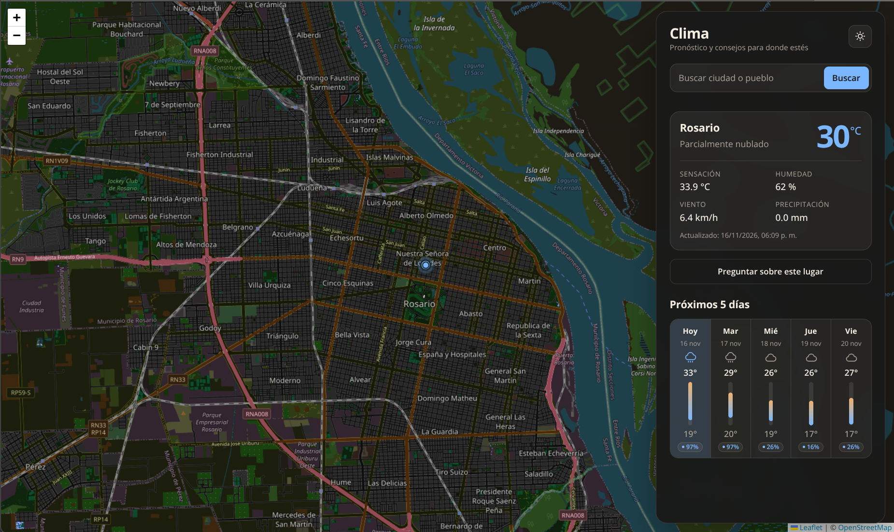

# Weather Dashboard


[**Probalo en vivo**](https://weather.fabricioporcelli.com.ar/) · [Cómo lo hosteo](https://portfolio.fabricioporcelli.com.ar/projects/homelab.html) · [API](https://github.com/FabricioPorcelli/weather-api) · [Asistente](https://github.com/FabricioPorcelli/weather-assistant)

Dashboard de clima con mapa interactivo, pronóstico de 5 días y un asistente conversacional opcional. Está hecho con **HTML, CSS y JavaScript vanilla**, sin frameworks ni build. El runtime no tiene dependencias: los tests E2E usan Playwright solo como herramienta de desarrollo.

La aplicación corre en un **self-hosted home lab**. En mi portfolio explico cómo está montada la infraestructura: [portfolio.fabricioporcelli.com.ar/projects/homelab.html](https://portfolio.fabricioporcelli.com.ar/projects/homelab.html).



## Qué podés hacer

- Elegir una ubicación tocando el mapa, buscando una ciudad o pueblo, o usando la ubicación del navegador.
- Ver el clima actual: temperatura, sensación térmica, humedad, viento y precipitación.
- Reintentar la última consulta si la API falla.
- El pin sigue el punto exacto del clic, pero el clima se consulta por una celda de ~1 km para aprovechar la caché.
- Consultar el pronóstico de los próximos 5 días con rangos de temperatura, íconos y probabilidad de lluvia.
- Cambiar entre la vista de 5 días y las próximas 24 horas con pestañas.
- Ver la actualización como “Actualizado ahora” o “Actualizado hace X minutos”.
- Cambiar entre tema claro y oscuro.
- Usar el dashboard desde la computadora o el celular.
- En móvil, arrastrar la barra superior del panel para colapsarlo y dejar a la vista el resumen y los detalles del clima.
- Navegar el panel y el chat con teclado; el chat móvil mantiene el foco adentro.
- Abrir el asistente y preguntar cosas como “¿Llevo paraguas hoy?” o “¿Qué ropa me pongo?”.
- Retomar conversaciones guardadas desde los puntos que quedan marcados en el mapa.

El asistente es opcional: si no está disponible, el clima y el pronóstico siguen funcionando.

## Cómo está armado

```text
weather-dashboard ──> weather-api ──> Visual Crossing
        │
        └──────────> weather-assistant ──> LLM
```

El dashboard consume dos servicios separados:

- [**weather-api**](https://github.com/FabricioPorcelli/weather-api): normaliza los datos de Visual Crossing, cachea con Redis y aplica rate limiting.
- [**weather-assistant**](https://github.com/FabricioPorcelli/weather-assistant): genera consejos deterministas y respuestas conversacionales con un LLM.

## Tecnologías

- HTML, CSS y JavaScript vanilla con ES Modules.
- Leaflet para el mapa y Open Sans para la tipografía.
- Nominatim para geocodificación, con Open-Meteo como fallback.
- FastAPI, Redis, PostgreSQL y un LLM del lado de los servicios.

## Probarlo en local

Necesitás la Weather API corriendo en `http://localhost:8000`.

```bash
# 1. Levantar la API
cd weather-api
cp .env.example .env          # completar WEATHER_API_KEY
docker compose up -d --build

# 2. Servir el dashboard
cd ../weather-dashboard
python3 -m http.server 5500
```

Abrí `http://localhost:5500`.

Si usás otro puerto, agregalo a `CORS_ORIGINS` en el `.env` de la API.

Para habilitar el chat, seguí las instrucciones de [weather-assistant](https://github.com/FabricioPorcelli/weather-assistant) y levantá también ese servicio.

## Tests

Los 15 tests E2E cubren búsqueda con fallback, clic en el mapa, tema, geolocalización, reintento, pronóstico horario, foco del buscador, historial viejo del chat, animación del chat, bottom sheet móvil y apertura/cierre del chat. Mockean las APIs, así que no necesitan claves ni servicios levantados. Solo necesitan red para cargar Leaflet desde su CDN.

```bash
npm ci
npx playwright install chromium
npm test
```

También podés verificar la sintaxis de los módulos con `npm run check:js`. El workflow de GitHub Actions corre todo en cada push a `main` y en cada pull request.

## En vivo

- **Aplicación:** https://weather.fabricioporcelli.com.ar/
- **Infraestructura:** [self-hosted home lab](https://portfolio.fabricioporcelli.com.ar/projects/homelab.html)

El despliegue está gestionado con Coolify y Cloudflare sobre un servidor propio. La API key de Visual Crossing y la clave del LLM viven únicamente en los backends; el frontend es estático y no contiene secretos.

## Sobre el proyecto

Es parte de mi portfolio. La idea fue practicar el ciclo completo: consumo de APIs, mapas, estados de carga y error, diseño responsive, streaming con SSE y despliegue self-hosted.

Más proyectos en [portfolio.fabricioporcelli.com.ar](https://portfolio.fabricioporcelli.com.ar/).
