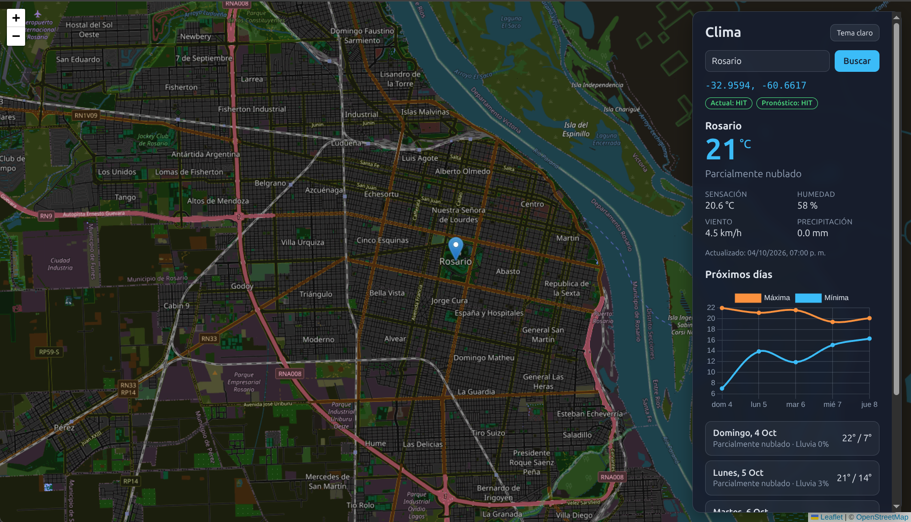

# Weather Dashboard

Dashboard web estático que muestra el clima actual y el pronóstico de 5 días de una ubicación elegida en un mapa. Consume la **Weather API** (proyecto separado que envuelve Visual Crossing) y usa Leaflet y Chart.js por CDN, **sin frameworks, sin build y sin `node_modules`**: el objetivo es practicar `fetch`, DOM y el ciclo request/response.

> Repo de la API: https://github.com/FabricioPorcelli/weather-api. Instrucciones para levantarla más abajo.



## Funcionalidades

- Mapa Leaflet a pantalla completa con tiles de OpenStreetMap y apariencia oscura.
- **Clic en el mapa**: clima actual + pronóstico de 5 días, pedidos en paralelo.
- **Búsqueda por ciudad** con geocodificación (Nominatim) y recentrado del mapa.
- Tarjeta con temperatura, sensación térmica, humedad, viento, precipitación y condiciones.
- Gráfico de temperaturas máximas/mínimas (Chart.js) y listado diario con probabilidad de lluvia.
- Tema claro/oscuro (guardado en `localStorage`) que también ajusta el mapa y el gráfico.
- Restauración de la última ubicación y el zoom al abrir.
- Badges de `X-Cache` (HIT/MISS) para ver la caché de la API en acción.
- Estados de carga y errores claros: 404, 422, 429, 502, 504 y API caída.

## Tecnologías

- HTML, CSS y JavaScript vanilla con **ES Modules**.
- [Leaflet 1.9.4](https://leafletjs.com/) (mapa) y [Chart.js 4.4.7](https://www.chartjs.org/) (gráfico), por CDN.
- [Nominatim](https://nominatim.org/) (OpenStreetMap) para convertir nombres de ciudades en coordenadas.
- [Weather API](https://github.com/FabricioPorcelli/weather-api) (FastAPI + Redis) como fuente de datos, corriendo en `localhost:8000`.

## Decisiones técnicas

- **Sin frameworks ni build**: HTML, CSS y JavaScript vanilla con ES Modules;
  el foco está en el ciclo request/response y el DOM, no en herramientas.
- **Coordenadas redondeadas y dedupe**: se redondea a 2 decimales (igual que la
  API) y no se repite el request si el punto no cambió; así se aprovecha la
  caché y se cuida el rate limit.
- **Errores por código HTTP**: la UI traduce 404, 422, 429, 502, 504 y caída de
  la API a mensajes claros, y descarta respuestas viejas con un `requestId`.
- **APIs públicas con respeto**: Nominatim se consulta solo con acción explícita
  del usuario, con caché en memoria y espera de 1 req/s según su política.
- **Separación por módulos**: `api`, `geocode`, `map`, `chart`, `ui`, `storage`
  y `main` con una única dirección de dependencias; la UI no conoce detalles de HTTP.

## Requisitos

- La Weather API corriendo en `http://localhost:8000` (Docker + Redis).
- Un servidor estático en el puerto 5500:
  - VS Code con la extensión [Live Server](https://marketplace.visualstudio.com/items?itemName=ritwickdey.LiveServer), o
  - Python: `python3 -m http.server 5500`.

> El dashboard usa ES Modules, por lo que **no** funciona abriendo `index.html`
> con doble clic (`file://`): necesita servirse por HTTP.

## Puesta en marcha

### 1. Levantar la API

En el repo de la API (ruta local sugerida `~/Documents/weather-api`):

```bash
cp .env.example .env          # completar WEATHER_API_KEY (Visual Crossing, gratis)
docker compose up -d --build  # API en http://localhost:8000 + Redis
```

Habilitar CORS para el dashboard en `weather-api/.env`:

```bash
CORS_ORIGINS=http://localhost:5500,http://127.0.0.1:5500
```

Después de editar el `.env` hay que **recrear** el contenedor (no alcanza con reiniciarlo):

```bash
docker compose up -d api
```

Verificación rápida:

```bash
curl -s -i -H "Origin: http://localhost:5500" http://localhost:8000/v1/weather/Madrid | grep -i access-control-allow-origin
```

Debe imprimir `access-control-allow-origin: http://localhost:5500`.

### 2. Levantar el dashboard

Con Live Server: abrí la carpeta del proyecto en VS Code y tocá **Go Live**
(queda en `http://127.0.0.1:5500`).

O con Python:

```bash
python3 -m http.server 5500
```

Si usás otro puerto, actualizá `CORS_ORIGINS` en el `.env` de la API.

## Configuración

Todo lo ajustable está en `js/config.js`:

| Constante | Descripción | Valor por defecto |
|---|---|---|
| `API_BASE_URL` | URL base de la Weather API | `http://localhost:8000` |
| `FORECAST_DAYS` | Días de pronóstico (1 a 15) | `5` |
| `COORD_DECIMALS` | Decimales de las coordenadas enviadas | `2` (~1 km, igual que la API) |
| `CITY_ZOOM` | Zoom al centrar una ciudad buscada | `13` |
| `INITIAL_VIEW` | Vista inicial del mapa | Buenos Aires, zoom 12 |
| `STORAGE_KEYS` | Claves de `localStorage` | tema y última ubicación |

## Estructura

```
weather-dashboard/
├── index.html      # estructura, CDN de Leaflet/Chart.js y entrada del módulo
├── styles.css      # layout, tarjetas y temas claro/oscuro con variables CSS
├── js/
│   ├── config.js   # constantes compartidas
│   ├── storage.js  # persistencia en localStorage (tema y última ubicación)
│   ├── api.js      # fetch a la Weather API, errores tipados y X-Cache
│   ├── text.js     # normalización de nombres de lugares
│   ├── geocode.js  # búsqueda de ciudades en Nominatim
│   ├── map.js      # Leaflet: mapa, marcador, recentrado y tema de los tiles
│   ├── chart.js    # gráfico de máximas/mínimas con Chart.js
│   ├── ui.js       # render del panel, estados, badges y tema
│   └── main.js     # punto de entrada: conecta eventos y módulos
└── README.md
```

## API que consume

| Endpoint | Uso |
|---|---|
| `GET /v1/weather/coords/{lat}/{lon}` | Clima actual por clic en el mapa |
| `GET /v1/forecast/coords/{lat}/{lon}?days=5` | Pronóstico por clic en el mapa |
| `GET /v1/weather/{city}` | Clima actual por ciudad |
| `GET /v1/forecast/{city}?days=5` | Pronóstico por ciudad |

Todas las respuestas incluyen el header `X-Cache` (`HIT`/`MISS`), que el
dashboard muestra en pantalla.

## Notas

- **Rate limit**: 10 req/min por IP. Durante el desarrollo se puede subir con
  `RATE_LIMIT` en el `.env` de la API y recreando el contenedor.
- **Redondeo**: las coordenadas se redondean a 2 decimales (~1 km) en el
  frontend y en la API, así los clics vecinos comparten respuesta y caché. Si
  el punto no cambió respecto de la última consulta, no se repite el request.
- **Nominatim**: se consulta solo al presionar Enter/botón (nunca mientras se
  escribe), respetando el límite de 1 request/segundo y con caché en memoria.
- **`localStorage`**: `weather-dashboard:theme` y
  `weather-dashboard:last-location`. Borralas para volver al estado inicial.

## Despliegue

El dashboard es estático y puede publicarse gratis en GitHub Pages, Netlify o
Vercel. Para que funcione en un dominio público:

1. Hostear la Weather API (Render, Railway, Fly.io, etc.).
2. Setear `CORS_ORIGINS` en la API con el dominio real del dashboard.
3. Apuntar `API_BASE_URL` en `js/config.js` al dominio de la API.

La `WEATHER_API_KEY` vive únicamente en el backend de la API: al ser un
frontend estático, todo lo que llega al navegador es visible, así que ninguna
credencial debe incluirse en este repo.
